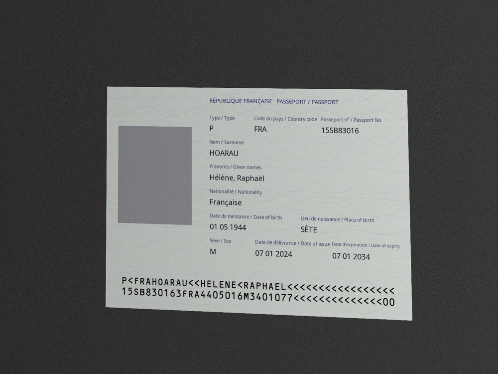
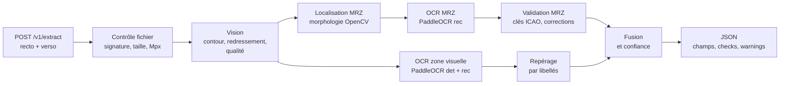

# Visiondoc

**API d'extraction des pièces d'identité françaises** (nouvelle CNI, ancienne CNI, passeport) : à partir d'une photo, elle renvoie les données en JSON, une MRZ validée et un niveau de confiance par champ. Tout tourne sur CPU, sans API externe, et aucune image ne touche le disque.


<p align="center"></p>

```jsonc
// POST /v1/extract — réponse réelle sur le spécimen ci-dessus (extrait)
{
  "document_type": "fr_passport",
  "fields": {
    "last_name":   { "value": "HOARAU",          "confidence": 1.0, "source": "mrz" },
    "first_names": { "value": ["HELENE", "RAPHAEL"], "confidence": 1.0, "source": "mrz" },
    "birth_date":  { "value": "1944-05-01",      "confidence": 1.0, "source": "mrz" },
    "issue_date":  { "value": "2024-01-07",      "confidence": 0.9, "source": "ocr" },
    "birth_place": { "value": "SETE",            "confidence": 0.7, "source": "ocr" }
  },
  "mrz": { "format": "TD3", "checksums_valid": true },
  "checks": [
    { "code": "mrz_checksums",      "status": "pass" },
    { "code": "mrz_matches_visual", "status": "pass" },
    { "code": "document_expired",   "status": "pass" }
  ],
  "warnings": [],
  "processing_ms": 4727
}
```

> Le dépôt ne contient aucune vraie pièce d'identité, ni dans les tests, ni dans les benchmarks, ni dans les journaux : uniquement des spécimens synthétiques générés par `inference.synth`.

## Le problème

Constituer un dossier (embauche, location, onboarding client) demande encore de recopier à la main les informations d'une pièce d'identité. La lecture automatique bute sur trois difficultés :
- les photos prises au téléphone sont de biais, floues ou mal éclairées ;
- l'OCR confond `O` et `0`, `I` et `1`, `S` et `5` ;
- une valeur fausse qui passe inaperçue coûte plus cher qu'un champ laissé vide.

Visiondoc vise donc **zéro erreur silencieuse**. Chaque champ porte une confiance et une source, et un champ douteux est toujours signalé.

## Résultats

Benchmark sur 300 spécimens synthétiques (100 par type), sur une machine x86 de CI à 2 processeurs ([rapport complet](benchmarks/reports/2026-10-23-ci-x86.md)) :

| | Nouvelle CNI | Ancienne CNI | Passeport |
|---|---|---|---|
| Documents acceptés | 100 % | 100 % | 100 % |
| Tous les champs exacts | 89 % | 98 % | 94 % |
| Temps médian | 3,6 s | 2,9 s | 2,7 s |

- **2 500 champs évalués, 99,2 % exacts, 0 champ faux non signalé** : chaque erreur est marquée par une confiance inférieure à 0,9 ou par un avertissement.
- 17 conditions de prise de vue dégradées sont testées (flou, pénombre, surexposition, perspective, rotation…).

## Fonctionnalités

- **3 types de documents** : nouvelle CNI (MRZ TD1 au verso), ancienne CNI (MRZ propre à la France), passeport (TD3). Les faces peuvent être envoyées dans n'importe quel ordre.
- **Validation de la MRZ** : clés de contrôle ICAO 7-3-1, correction des confusions de l'OCR uniquement quand la nature du champ est certaine, chaque correction étant tracée.
- **Lecture de la zone visuelle** : lieu et date de naissance, date de délivrance, prénoms avec accents, avec repérage des libellés français et anglais.
- **Fusion et confiance** : un champ vaut 1,0 s'il vient d'une MRZ valide, 0,9 s'il est confirmé par deux sources, 0,7 s'il vient de la seule zone visuelle, et 0,3 si la clé de contrôle de la MRZ est fausse.
- **Règles métier** : contrôle d'expiration, prolongation de 5 ans des anciennes CNI (décret n° 2013-1188), cohérence entre dates de délivrance et d'expiration.
- **Refus explicites** : image floue, trop sombre, trop petite ou document coupé, avec un code d'erreur exploitable par le front.

## Architecture



| Module | Rôle |
|---|---|
| [`api/`](apps/inference/src/inference/api) | FastAPI, authentification, lecture multipart en mémoire, journaux JSON |
| [`vision/`](apps/inference/src/inference/vision) | Vérification du fichier, détection du document, contrôle de qualité, localisation de la MRZ |
| [`ocr/`](apps/inference/src/inference/ocr) | Interfaces `LineRecognizer` et `TextEngine` (PaddleOCR en production, implémentations factices en test) |
| [`mrz/`](apps/inference/src/inference/mrz) | Parseurs TD1, TD3 et ancienne CNI, sommes de contrôle, réparation, générateur |
| [`pipeline/`](apps/inference/src/inference/pipeline) | Orchestration, champs visuels, fusion et modèle de réponse |
| [`synth/`](apps/inference/src/inference/synth) | Générateur de spécimens synthétiques pour les tests et le benchmark |

### Choix techniques

Chaque décision est documentée et chiffrée dans un [ADR](docs/adr) :

- **[Limites de l'algorithme ICAO](docs/adr/0002-lecture-mrz.md)** : la clé 7-3-1 ne distingue pas `A` de `0` ni `<` de `0`. Ces cas ont été comptés sur toutes les substitutions possibles d'un caractère, et la comparaison avec la zone visuelle sert de filet de sécurité.
- **[Pas fixe pour l'OCR de la MRZ](docs/adr/0003-vision-et-lecture-mrz.md)** : le décodeur CTC fusionne les `<` consécutifs. Étirer chaque ligne fait passer les lectures exactes de 55 % à 93 %.
- **[Une clé fausse prime sur un accord visuel](docs/adr/0004-zone-visuelle-et-fusion.md)** : le benchmark a montré que l'OCR peut faire la même confusion dans la MRZ et dans la zone visuelle.
- **[Seuils de qualité calibrés](docs/adr/0006-benchmark-et-calibrage.md)** : les contrôles sont désactivés, on extrait quand même, puis on compare le résultat à la mesure de qualité. On ne refuse que ce qui est certainement illisible.
- **pypdfium2 plutôt que PyMuPDF** pour les PDF, à cause de la licence AGPL de PyMuPDF. Le rendu est isolé dans un processus tué après 15 s.

## Sécurité et données personnelles

Le service traite des pièces d'identité : la protection des données fait partie de la conception dès le départ ([ADR 0005](docs/adr/0005-api-et-conteneur.md)).

- **Aucune écriture sur disque** : le multipart est lu en flux et en mémoire, alors que Starlette passe par un fichier temporaire au-delà de 1 Mo. Un test vérifie qu'aucun fichier n'est créé, et le conteneur tourne en lecture seule.
- **Clés API stockées sous forme d'empreintes SHA-256** et comparées en temps constant. Sans clé configurée, toute requête est refusée.
- **Journaux sans données** : seulement des métadonnées techniques (route, statut, durée, code d'erreur), jamais d'image, de valeur extraite ni de message d'exception.
- **Protection contre les fichiers piégés** : type vérifié par signature binaire, 10 Mo au maximum, 40 Mpx contrôlés avant décodage, PDF d'une seule page rendu dans un processus isolé.
- **Conteneur durci** : utilisateur non root, toutes les capacités Linux retirées, `no-new-privileges`, port publié sur `127.0.0.1`, modèles embarqués à la construction (aucun accès réseau au démarrage).

## Lancer en local

Prérequis : Docker. L'image est `linux/amd64` car PaddlePaddle ne publie pas de paquet Linux ARM ; sur Apple Silicon, elle tourne en émulation.

```bash
cp .env.example .env
docker compose build
docker compose run --rm inference python -m inference.api.keys   # crée une clé API
# copier l'empreinte affichée dans VISIONDOC_API_KEY_HASHES (fichier .env)
docker compose up -d
```

```bash
curl -X POST http://127.0.0.1:8000/v1/extract \
  -H "Authorization: Bearer $VISIONDOC_KEY" \
  -F front=@recto.jpg -F back=@verso.jpg
```

- `front` est obligatoire, `back` est facultatif. Formats acceptés : JPEG, PNG ou PDF d'une page, 10 Mo au maximum par face.
- Pour une nouvelle CNI, la MRZ est au verso : il faut envoyer les deux faces.
- Documentation interactive : http://127.0.0.1:8000/docs · état du service : `GET /health`.

## Développer et tester

```bash
cd apps/inference
uv sync --extra ocr
uv run pytest                 # tests rapides, avec des lecteurs factices
uv run pytest -m slow         # tests avec les vrais modèles PaddleOCR
uv run ruff check . && uv run mypy
uv run python -m inference.synth --kind fr_passport --out /tmp/specimen.jpg
```

- **231 tests rapides**, plus des tests lents sur les vrais modèles. Les tests de propriétés (Hypothesis) couvrent les MRZ : aller-retour génération → lecture, et mutations d'un caractère.
- **La CI GitHub Actions** lance ruff, mypy strict et pytest avec couverture, puis les tests OCR réels, construit l'image Docker et exécute un test de fumée sur le conteneur en lecture seule.
- **Le benchmark** ([`benchmarks/`](benchmarks)) est déclenché à la demande en CI, dans l'image de production.

## Structure

```
apps/inference/      service d'inférence (Python 3.12, uv, src layout)
  src/inference/     api, vision, ocr, mrz, pipeline, synth
  tests/             un dossier par module
benchmarks/          scripts de mesure, rapports datés, spécimens annotés
docs/
  specification.md   spécification fonctionnelle et technique
  adr/               décisions d'architecture
```

## Pistes d'amélioration

- Recalibrer les seuils de qualité sur de vraies photos de spécimens officiels (aujourd'hui calibrés sur des images synthétiques).
- V1 : plateforme de collecte de dossiers autour de ce service (`apps/api`, `apps/web`), décrite dans la [spécification](docs/specification.md).
- Image ARM native dès que PaddlePaddle publiera un paquet Linux ARM.

## Auteur

**Manuel Briand** · [GitHub](https://github.com/ManuelBriand) · [Site](https://manuelbriand.github.io)

Code publié à titre de démonstration, tous droits réservés.
